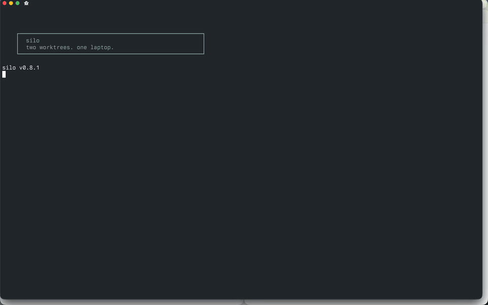

# silo

Isolated local development environments. silo solves instance isolation and k3d bootstrap sequencing for Tilt-based projects.

[](https://github.com/alleneubank/silo/actions/workflows/ci.yml)
[](https://www.npmjs.com/package/@0xbigboss/silo)
[](LICENSE)



## Requirements

- Bun 1.4.4 (qualified runtime)
- Docker with a local Unix endpoint
- Tilt
- [janitor](https://github.com/alleneubank/janitor) 0.3.1 (process-group supervisor; see
  [Process supervision](#process-supervision))
- k3d (optional, only if `k3d.enabled = true`)

## Install

```bash
npm i -g @0xbigboss/silo
```

### Claude Code Skill

Install the silo skill in [Claude Code](https://claude.ai/code) so your AI assistant knows how to use silo:

```bash
/plugin marketplace add alleneubank/silo
/plugin install silo@alleneubank-silo
```

### Pi package

Install silo as a [pi package](https://pi.dev/packages) to expose the `silo` skill to the pi coding agent:

```bash
pi install git:https://github.com/alleneubank/silo.git
```

The skill shells out to the `silo` binary; install it first via `npm i -g @0xbigboss/silo` or the source build.

## Quick start

This breaking version requires a host cutover: announce it, upgrade or retire
every permitted old invocation, and wait for all old operations to finish
before the first new allocation. Each owner stops and recreates its ephemeral
projects. Legacy JSON entries/root locks cause read-only `LEGACY_STATE`;
nothing migrates or deletes automatically. See `silo doc troubleshooting`.

```bash
silo init
# edit silo.toml
silo up dev
```

Print the bundled `silo.toml` reference:

```bash
silo doc config
```

## Commands

```bash
silo init            # Create silo.toml starter config
silo up [name]       # Start environment (creates k3d if needed, starts Tilt)
silo down            # Stop environment (stops Tilt, keeps k3d by default)
silo status          # Show current instance state
silo env [name]      # Generate env file only, don't start anything
silo ci [name]       # Run Tilt in CI mode (tilt ci) after env + k3d setup
silo profiles        # List available profiles
silo doc [topic]     # Print bundled docs (config, profiles, k3d, hooks, etc.)
silo version         # Print version
```

## Configuration

`silo.toml` defines ports, hosts, URLs, k3d settings, and hooks. For the canonical reference, run:

```bash
silo doc config
```

You can also browse `SPEC.md` for a detailed specification.

## Child process environment

When silo launches child processes (Tilt, hooks, k3d, kubectl), it injects:

- `SILO_ACTIVE=1`
- `SILO_WORKSPACE=<workspace name>`
- `SILO_ENV_FILE=<absolute path to generated env file>`

## Process supervision

All mutating tools use durable gated Janitor groups with `--pgroup-only`.
Owner loss drains the recorded group; uncertain effects retain ownership.
A missing supervisor refuses startup. `--force` reconfigures only a stopped,
reconciled generation; parallel stacks need separate roots and names.

See `silo doc tilt` for the details.

## Working with a running stack

`silo status --json` reports canonical account ownership (generation, claims,
receipts and retained resources). It does not report Tilt resource health.
After `silo up`, source `.localnet.env` and talk to the Tilt API:

```bash
tilt get uiresources --port "$TILT_PORT"
```

For HTTP, use the printed `*.localhost` URLs, not `localhost:PORT`. See `silo doc tilt`.

## CI usage

`silo env` and `silo ci` auto-export env vars to `$GITHUB_ENV` when running in
CI (or when `--export-ci` is provided), and skip the export with a warning when
`$GITHUB_ENV` is not set. `silo ci` also sets `CI=true` for Tilt, so Tiltfiles
that gate e2e resources on `CI` run them:

```bash
silo ci e2e --timeout 300s
```

If your `Tiltfile` uses the silo requirement extension in CI, prefer loading it
from installed dependencies instead of `v1alpha1.extension_repo()`:

```python
load('./node_modules/@0xbigboss/silo/tilt-extensions/silo/require/Tiltfile', 'SILO_REQUIRE')
```

## Development

See [CONTRIBUTING.md](CONTRIBUTING.md).

## License

MIT. See [LICENSE](LICENSE).

Report vulnerabilities to the address in [SECURITY.md](SECURITY.md).
